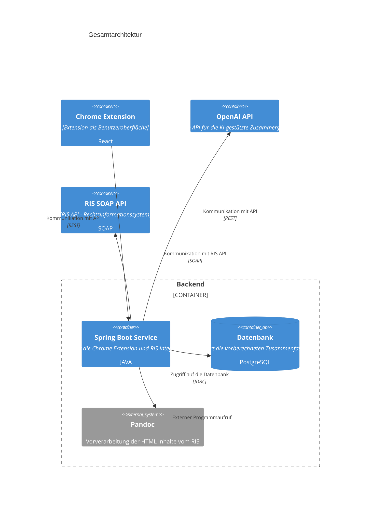

# Shrinkwrap.Legal

# Einführung und Ziele

## Aufgabenstellung

- kurzer Textg
- eventuell Use-Case

Shrinkwrap Legal ist eine Browser Extension für Chrome, Edge und Firefox, welche Judikate aus dem RIS (Rechtsinformationssystem) der Republik Österreich vereinfacht aufbereitet und zusammenfasst. Diese Datenaufbereitung erfolgt mit großen Sprachmodellen (LLM) über die OpenAI Schnittstelle.

## Qualitätsziele

1. Performance und Skalierbarkeit 

2. Zuverlässigkeit und Verfügbarkeit 

3. Sicherheit 
 - Es soll kein eigener Inhalt an die OpenAI Schnittstelle weitergeleitet werden können 
 
 4. Wartbarkeit und Entwicklungsfähigkeit 

Hier ein Überblick möglicher Themen (basierend auf dem ISO 25010
Standard):

<figure>

</figure>

## Stakeholder

| Person/Organisation | Kontakt | Rolle | Erwartungshaltung |
|----------|----------|----------|----------|
| NetIdee |  | Organisation Fördergeber |  |
| Thoms Schreiber | thomas@outlook.at |  |  |
| Bernhard Jungwirth | bernhard@it.jungwirth.me  | Software Entwickler |  |

# Randbedingungen

- Das Ergebnis muss Open Source sein 
- Definierter Zeitrahmen ist vorgegeben 
- Form: einfache Tabelle mit Erläuterung, eventuell nach technische, organisatorische und politische 

Weiterführende Informationen

Siehe [Randbedingungen](https://docs.arc42.org/section-2/) in der
online-Dokumentation (auf Englisch!).

# Kontextabgrenzung#
- fachliche und technische Schnittstellen 
- Abgrenzung zu Kommunikationspartner und Nachbarsysteme, 
- RIS Open Data Aufruf
- OpenAI Aufrufe
- Form: Kontextdiagramme, usw

Weiterführende Informationen

Siehe [Kontextabgrenzung](https://docs.arc42.org/section-3/) in der
online-Dokumentation (auf Englisch!).

## Fachlicher Kontext

- Festlegung **aller** Kommunikationsbeziehungen (Nutzer, IT-Systeme, …​)
- Datenformate und Protokolle der Kkommunikation mit NAchbarsystemen 
- Browser Extension 
- System als Blackbox mit Schnittstellen 

## Technischer Kontext

- Technische Schnittstellen 
- UML Deployment Diagramm mit Kanälen zu Nachbarsystemen 

# Lösungsstrategie

- Spring Boot als zentrales Backend 
- Aufrufe der OpenAI Schnittstelle aus Spring boot 
- React als UI in der Browser Extension
- Technologie Entscheidung 
- Erreichung der Qualitätsanforderungen (Egebnisse bleiben gespeichert, schnelle Ergebnisse )
- Entscheidungen beim Entwicklungsprozess
- Aufgabenstellung und Qualitätsziele, Randbedingungen 

Siehe [Lösungsstrategie](https://docs.arc42.org/section-4/) in der
online-Dokumentation (auf Englisch!).

# Bausteinsicht

Module, Komponenten, Subsysteme, Klassen, Schnittstellen, Pakete, Bibliotheken, Frameworks 

**Ebene 1** ist die Whitebox-Beschreibung des Gesamtsystems, zusammen
mit Blackbox-Beschreibungen der darin enthaltenen Bausteine.

**Ebene 2** zoomt in einige Bausteine der Ebene 1 hinein. Sie enthält
somit die Whitebox-Beschreibungen ausgewählter Bausteine der Ebene 1,
jeweils zusammen mit Blackbox-Beschreibungen darin enthaltener
Bausteine.

**Ebene 3** zoomt in einige Bausteine der Ebene 2 hinein, usw.

Weiterführende Informationen

Siehe [Bausteinsicht](https://docs.arc42.org/section-5/) in der
online-Dokumentation (auf Englisch!).

## Whitebox Gesamtsystem

An dieser Stelle beschreiben Sie die Zerlegung des Gesamtsystems anhand
des nachfolgenden Whitebox-Templates. Dieses enthält:

- Ein Übersichtsdiagramm

- die Begründung dieser Zerlegung

- Blackbox-Beschreibungen der hier enthaltenen Bausteine. Dafür haben
  Sie verschiedene Optionen:

  - in *einer* Tabelle, gibt einen kurzen und pragmatischen Überblick
    über die enthaltenen Bausteine sowie deren Schnittstellen.

  - als Liste von Blackbox-Beschreibungen der Bausteine, gemäß dem
    Blackbox-Template (siehe unten). Diese Liste können Sie, je nach
    Werkzeug, etwa in Form von Unterkapiteln (Text), Unter-Seiten (Wiki)
    oder geschachtelten Elementen (Modellierungswerkzeug) darstellen.

- (optional:) wichtige Schnittstellen, die nicht bereits im
  Blackbox-Template eines der Bausteine erläutert werden, aber für das
  Verständnis der Whitebox von zentraler Bedeutung sind. Aufgrund der
  vielfältigen Möglichkeiten oder Ausprägungen von Schnittstellen geben
  wir hierzu kein weiteres Template vor. Im schlimmsten Fall müssen Sie
  Syntax, Semantik, Protokolle, Fehlerverhalten, Restriktionen,
  Versionen, Qualitätseigenschaften, notwendige Kompatibilitäten und
  vieles mehr spezifizieren oder beschreiben. Im besten Fall kommen Sie
  mit Beispielen oder einfachen Signaturen zurecht.

***\<Übersichtsdiagramm\>***

Begründung  
*\<Erläuternder Text\>*

Enthaltene Bausteine  
*\<Beschreibung der enthaltenen Bausteine (Blackboxen)\>*

Wichtige Schnittstellen  
*\<Beschreibung wichtiger Schnittstellen\>*

Hier folgen jetzt Erläuterungen zu Blackboxen der Ebene 1.

Falls Sie die tabellarische Beschreibung wählen, so werden Blackboxen
darin nur mit Name und Verantwortung nach folgendem Muster beschrieben:

| **Name**         | **Verantwortung** |
|------------------|-------------------|
| *\<Blackbox 1\>* |  *\<Text\>*       |
| *\<Blackbox 2\>* |  *\<Text\>*       |

Falls Sie die ausführliche Liste von Blackbox-Beschreibungen wählen,
beschreiben Sie jede wichtige Blackbox in einem eigenen
Blackbox-Template. Dessen Überschrift ist jeweils der Namen dieser
Blackbox.

### \<Name Blackbox 1\>

Beschreiben Sie die \<Blackbox 1\> anhand des folgenden
Blackbox-Templates:

- Zweck/Verantwortung

- Schnittstelle(n), sofern diese nicht als eigenständige Beschreibungen
  herausgezogen sind. Hierzu gehören eventuell auch Qualitäts- und
  Leistungsmerkmale dieser Schnittstelle.

- (Optional) Qualitäts-/Leistungsmerkmale der Blackbox, beispielsweise
  Verfügbarkeit, Laufzeitverhalten o. Ä.

- (Optional) Ablageort/Datei(en)

- (Optional) Erfüllte Anforderungen, falls Sie Traceability zu
  Anforderungen benötigen.

- (Optional) Offene Punkte/Probleme/Risiken

*\<Zweck/Verantwortung\>*

*\<Schnittstelle(n)\>*

*\<(Optional) Qualitäts-/Leistungsmerkmale\>*

*\<(Optional) Ablageort/Datei(en)\>*

*\<(Optional) Erfüllte Anforderungen\>*

*\<(optional) Offene Punkte/Probleme/Risiken\>*

### \<Name Blackbox 2\>

*\<Blackbox-Template\>*

### \<Name Blackbox n\>

*\<Blackbox-Template\>*

### \<Name Schnittstelle 1\>

…​

### \<Name Schnittstelle m\>

## Ebene 2

Beschreiben Sie den inneren Aufbau (einiger) Bausteine aus Ebene 1 als
Whitebox.

Welche Bausteine Ihres Systems Sie hier beschreiben, müssen Sie selbst
entscheiden. Bitte stellen Sie dabei Relevanz vor Vollständigkeit.
Skizzieren Sie wichtige, überraschende, riskante, komplexe oder
besonders volatile Bausteine. Normale, einfache oder standardisierte
Teile sollten Sie weglassen.

### Whitebox *\<Baustein 1\>*

…​zeigt das Innenleben von *Baustein 1*.

*\<Whitebox-Template\>*

### Whitebox *\<Baustein 2\>*

*\<Whitebox-Template\>*

…​

### Whitebox *\<Baustein m\>*

*\<Whitebox-Template\>*

## Ebene 3

Beschreiben Sie den inneren Aufbau (einiger) Bausteine aus Ebene 2 als
Whitebox.

Bei tieferen Gliederungen der Architektur kopieren Sie diesen Teil von
arc42 für die weiteren Ebenen.

### Whitebox \<\_Baustein x.1\_\>

…​zeigt das Innenleben von *Baustein x.1*.

*\<Whitebox-Template\>*

### Whitebox \<\_Baustein x.2\_\>

*\<Whitebox-Template\>*

### Whitebox \<\_Baustein y.1\_\>

*\<Whitebox-Template\>*

# Laufzeitsicht

Inhalt

Diese Sicht erklärt konkrete Abläufe und Beziehungen zwischen Bausteinen
in Form von Szenarien aus den folgenden Bereichen:

- Wichtige Abläufe oder *Features*: Wie führen die Bausteine der
  Architektur die wichtigsten Abläufe durch?

- Interaktionen an kritischen externen Schnittstellen: Wie arbeiten
  Bausteine mit Nutzern und Nachbarsystemen zusammen?

- Betrieb und Administration: Inbetriebnahme, Start, Stop.

- Fehler- und Ausnahmeszenarien

Anmerkung: Das Kriterium für die Auswahl der möglichen Szenarien (d.h.
Abläufe) des Systems ist deren Architekturrelevanz. Es geht nicht darum,
möglichst viele Abläufe darzustellen, sondern eine angemessene Auswahl
zu dokumentieren.

Motivation

Sie sollten verstehen, wie (Instanzen von) Bausteine(n) Ihres Systems
ihre jeweiligen Aufgaben erfüllen und zur Laufzeit miteinander
kommunizieren.

Nutzen Sie diese Szenarien in der Dokumentation hauptsächlich für eine
verständlichere Kommunikation mit denjenigen Stakeholdern, die die
statischen Modelle (z.B. Bausteinsicht, Verteilungssicht) weniger
verständlich finden.

Form

Für die Beschreibung von Szenarien gibt es zahlreiche
Ausdrucksmöglichkeiten. Nutzen Sie beispielsweise:

- Nummerierte Schrittfolgen oder Aufzählungen in Umgangssprache

- Aktivitäts- oder Flussdiagramme

- Sequenzdiagramme

- BPMN (Geschäftsprozessmodell und -notation) oder EPKs
  (Ereignis-Prozessketten)

- Zustandsautomaten

- …​

Weiterführende Informationen

Siehe [Laufzeitsicht](https://docs.arc42.org/section-6/) in der
online-Dokumentation (auf Englisch!).

## *\<Bezeichnung Laufzeitszenario 1\>*

- \<hier Laufzeitdiagramm oder Ablaufbeschreibung einfügen\>

- \<hier Besonderheiten bei dem Zusammenspiel der Bausteine in diesem
  Szenario erläutern\>

## *\<Bezeichnung Laufzeitszenario 2\>*

…​

## *\<Bezeichnung Laufzeitszenario n\>*

…​

# Verteilungssicht

Inhalt

Die Verteilungssicht beschreibt:

1.  die technische Infrastruktur, auf der Ihr System ausgeführt wird,
    mit Infrastrukturelementen wie Standorten, Umgebungen, Rechnern,
    Prozessoren, Kanälen und Netztopologien sowie sonstigen
    Bestandteilen, und

2.  die Abbildung von (Software-)Bausteinen auf diese Infrastruktur.

Häufig laufen Systeme in unterschiedlichen Umgebungen, beispielsweise
Entwicklung-/Test- oder Produktionsumgebungen. In solchen Fällen sollten
Sie alle relevanten Umgebungen aufzeigen.

Nutzen Sie die Verteilungssicht insbesondere dann, wenn Ihre Software
auf mehr als einem Rechner, Prozessor, Server oder Container abläuft
oder Sie Ihre Hardware sogar selbst konstruieren.

Aus Softwaresicht genügt es, auf die Aspekte zu achten, die für die
Softwareverteilung relevant sind. Insbesondere bei der
Hardwareentwicklung kann es notwendig sein, die Infrastruktur mit
beliebigen Details zu beschreiben.

Motivation

Software läuft nicht ohne Infrastruktur. Diese zugrundeliegende
Infrastruktur beeinflusst Ihr System und/oder querschnittliche
Lösungskonzepte, daher müssen Sie diese Infrastruktur kennen.

Form

Das oberste Verteilungsdiagramm könnte bereits in Ihrem technischen
Kontext enthalten sein, mit Ihrer Infrastruktur als EINE Blackbox. Jetzt
zoomen Sie in diese Infrastruktur mit weiteren Verteilungsdiagrammen
hinein:

- Die UML stellt mit Verteilungsdiagrammen (Deployment diagrams) eine
  Diagrammart zur Verfügung, um diese Sicht auszudrücken. Nutzen Sie
  diese, evtl. auch geschachtelt, wenn Ihre Verteilungsstruktur es
  verlangt.

- Falls Ihre Infrastruktur-Stakeholder andere Diagrammarten bevorzugen,
  die beispielsweise Prozessoren und Kanäle zeigen, sind diese hier
  ebenfalls einsetzbar.

Weiterführende Informationen

Siehe [Verteilungssicht](https://docs.arc42.org/section-7/) in der
online-Dokumentation (auf Englisch!).

## Infrastruktur Ebene 1

An dieser Stelle beschreiben Sie (als Kombination von Diagrammen mit
Tabellen oder Texten):

- die Verteilung des Gesamtsystems auf mehrere Standorte, Umgebungen,
  Rechner, Prozessoren o. Ä., sowie die physischen Verbindungskanäle
  zwischen diesen,

- wichtige Begründungen für diese Verteilungsstruktur,

- Qualitäts- und/oder Leistungsmerkmale dieser Infrastruktur,

- Zuordnung von Softwareartefakten zu Bestandteilen der Infrastruktur

Für mehrere Umgebungen oder alternative Deployments kopieren Sie diesen
Teil von arc42 für alle wichtigen Umgebungen/Varianten.

***\<Übersichtsdiagramm\>***

Begründung  
*\<Erläuternder Text\>*

Qualitäts- und/oder Leistungsmerkmale  
*\<Erläuternder Text\>*

Zuordnung von Bausteinen zu Infrastruktur  
*\<Beschreibung der Zuordnung\>*

## Infrastruktur Ebene 2

An dieser Stelle können Sie den inneren Aufbau (einiger)
Infrastrukturelemente aus Ebene 1 beschreiben.

Für jedes Infrastrukturelement kopieren Sie die Struktur aus Ebene 1.

### *\<Infrastrukturelement 1\>*

*\<Diagramm + Erläuterungen\>*

### *\<Infrastrukturelement 2\>*

*\<Diagramm + Erläuterungen\>*

…​

### *\<Infrastrukturelement n\>*

*\<Diagramm + Erläuterungen\>*

# Querschnittliche Konzepte

Inhalt

Dieser Abschnitt beschreibt übergreifende, prinzipielle Regelungen und
Lösungsansätze, die an mehreren Stellen (=*querschnittlich*) relevant
sind.

Solche Konzepte betreffen oft mehrere Bausteine. Dazu können vielerlei
Themen gehören, wie beispielsweise die Themen aus dem nachfolgenden
Diagramm:

<figure>

</figure>

Motivation

Konzepte bilden die Grundlage für *konzeptionelle Integrität*
(Konsistenz, Homogenität) der Architektur und damit eine wesentliche
Grundlage für die innere Qualität Ihrer Systeme.

Dieser Abschnitt im Template ist der richtige Ort für die konsistente
Behandlung solcher Themen.

Viele solche Konzepte beeinflussen oder beziehen sich auf mehrerer Ihrer
Bausteine.

Form

Kann vielfältig sein:

- Konzeptpapiere mit beliebiger Gliederung,

- beispielhafte Implementierung speziell für technische Konzepte,

- übergreifende Modelle/Szenarien mit Notationen, die Sie auch in den
  Architektursichten nutzen,

Struktur

Wählen Sie **nur** die wichtigsten Themen für Ihr System und erklären
das jeweilige Konzept dann unter einer Level-2 Überschrift dieser
Sektion (z.B. 8.1, 8.2 etc).

Beschränken Sie sich auf die wichtigen, und versuchen **auf keinen
Fall** alle oben dargestellten Themen zu bearbeiten.

Weiterführende Informationen

Einige Themen innerhalb von Systemen betreffen oft mehrere Bausteine,
Hardwareelemente oder Prozesse. Es könnte einfacher sein, solche
*Querschnittsthemen* an einer zentralen Stelle zu kommunizieren oder zu
dokumentieren, anstatt sie in der Beschreibung der betreffenden
Bausteine, Hardwareelemente oder Entwicklungsprozesse zu wiederholen.

Bestimmte Konzepte können **alle** Elemente eines Systems betreffen,
andere sind vielleicht nur für einige wenige relevant.

Siehe [Querschnittliche Konzepte](https://docs.arc42.org/section-8/) in
der online-Dokumentation (auf Englisch).

## *\<Konzept 1\>*

*\<Erklärung\>*

## *\<Konzept 2\>*

*\<Erklärung\>*

…​

## *\<Konzept n\>*

*\<Erklärung\>*

# Architekturentscheidungen

## Entscheidung 1: Verwendung von OpenAI für die Aufbereitung von Judikaten 

## Entscheidung 2: Verwendung einer PostgreSQL-Datenbank 

- Alternative wäre auch eine Dateiablage gewesen 

## Entscheidung 3: Implementierung einer Chrome Extension für die Anzeige der aufbereiteten Judikate 

- Alternative wäre eine eigene Webanwendung gewesen 

## Entscheidung 4: Nutzung von Docker für die Containerisierung der Anwendung 

- ADR ([Documenting Architecture
  Decisions](https://cognitect.com/blog/2011/11/15/documenting-architecture-decisions))
  für jede wichtige Entscheidung

# Qualitätsanforderungen

- Siehe [Qualitätsanforderungen](https://docs.arc42.org/section-10/) in
  der online-Dokumentation (auf Englisch!).

- Siehe auch das ausführliche [Q42 Qualitätsmodell auf
  https://quality.arc42.org](https://quality.arc42.org).

## Übersicht der Qualitätsanforderungen
- einfache Tabelle 

## Qualitätsszenarien

- Qualitätsszenarien konkretisieren Qualitätsanforderungen 

Zwei Arten von Szenarien finden wir besonders nützlich:

- Nutzungsszenarien (auch bekannt als Anwendungs- oder
  Anwendungsfallszenarien) beschreiben, wie das System zur Laufzeit auf
  einen bestimmten Auslöser reagieren soll. Hierunter fallen auch
  Szenarien zur Beschreibung von Effizienz oder Performance. Beispiel:
  Das System beantwortet eine Benutzeranfrage innerhalb einer Sekunde.

- Änderungsszenarien

In Kurzform (bevorzugt im Q42-Modell):

- K**ontext/Hintergrund**: Um welche Art von System oder Komponente
  handelt es sich, wie sieht die Umgebung oder Situation aus?

- **Quelle/Stimulus**: Wer oder was initiiert oder löst ein Verhalten,
  eine Reaktion oder eine Aktion aus.

- **Metrik/Akzeptanzkriterien**: Eine Reaktion einschließlich einer
  *Maßnahme* oder *Metrik*

# Risiken und technische Schulden

## Risiken 

- geordnete Liste der erkannten Risiken 
- Zeitliche Verzögerung 
- Schlechte ERgebnisse der OpenAI Resultate 
- Maßnahmen zur Risikovermeidung und Minimierung 
- Bewertung der Ergebnisse des OpenAI Resultats 

# Glossar

| Begriff         | Kategorie         | Übersetzung        | Definition         |
|-----------------|-----------------|--------------------|--------------------|
| RIS | Fachlich | | Rechtsinformationssystem des Bundes (<https://ris.bka.gv.at>) |
| OpenAI | Technik |  | OpenAI ist ein Forschungsunternehmen für künstliche Intelligenz und bietet den Chatbot ChatGPT sowie technsiche Schnittstellen für diese Systeme an |
| Spring Boot | Technik |  | Framework zum Entwickeln von Webanwendungen/Backends in JAVA |
| JAVA | Technik |  | Programmiersprache |
| Chrome Extension | Technik |  | <https://developer.chrome.com/docs/extensions?hl=de>  |

**Über arc42**

arc42, das Template zur Dokumentation von Software- und
Systemarchitekturen.

Template Version 9.0-DE. (basiert auf der AsciiDoc Version), Juli 2025

Created, maintained and © by Dr. Peter Hruschka, Dr. Gernot Starke and
contributors. Siehe <https://arc42.org>.