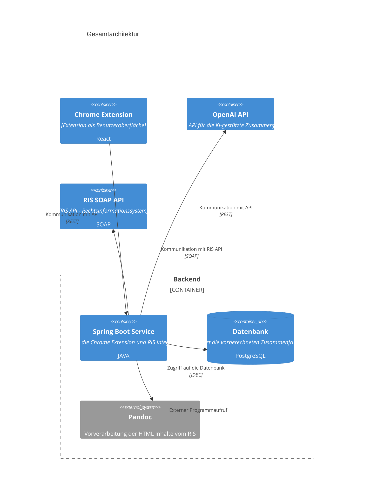
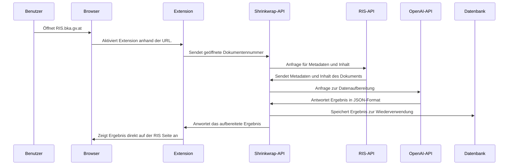
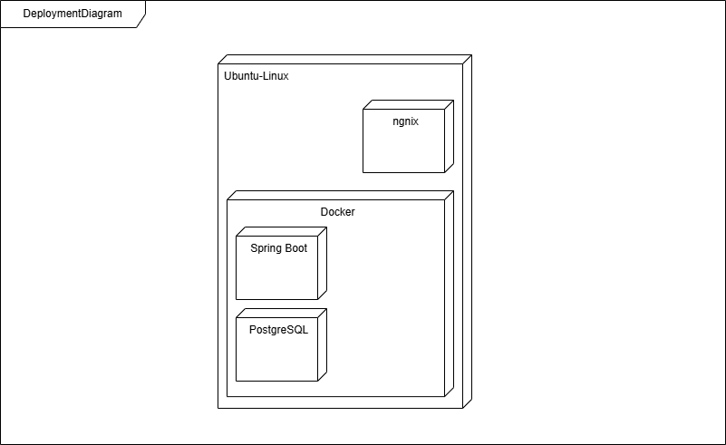
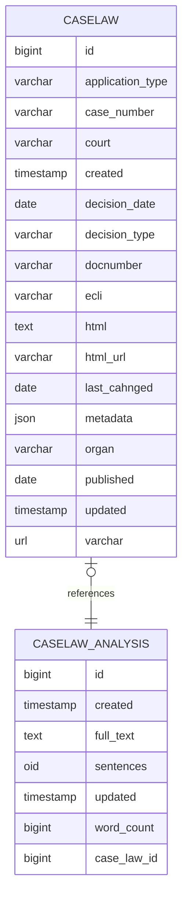

# Shrinkwrap.Legal

# Einführung und Ziele

## Aufgabenstellung

Rechtstexte sind in Österreich nur schwer verständlich, Gerichtsurteile oft sogar noch schwerer. Zweitere sind noch dazu sehr umfangreich, und relevante Informationen gut versteckt. Durch eine Kombination aus der Technologie hinter ChatGPT und einer Browser-Erweiterung möchten wir das RIS zugänglicher machen und insbesondere die Recherche von Urteilen stark vereinfachen. Urteile sollen damit automatisch zusammengefasst werden.

Gerichtsurteile sind lang, komplex und folgen an sich einer relativ genauen Struktur (Spruch, Feststellungen, Rechtliche Beurteilung, Beweiswürdigung, Kosten). Durch die Nutzung von GPT-Technologie lassen sich Urteilszusammenfassungen automatisch generieren und für verschiedene Zielgruppen aufbereiten. Durch Nutzung von Browser-Erweiterungen stehen diese direkt bei Nutzung des RIS zur Verfügung.

## Qualitätsziele

| Ziel | Beschreibung |
|-----|-----|
| Performance | Die Anwendung zeigt Zusammenfassungen direkt bei den Suchergebnissen an. Damit diese Ergebnisse schnell angezeigt werden, werden einmal berechnete Zusammenfassungen in einer Datenbank gespeichert.  |
| Effizienz | Die Erstellung von Zusammenfassungen mittels generativer KI ist rechen- und kostenaufwendig. Für einen effektiven Einsatz des KI-Services, werden einmal berechnete Ergebnisse in einer Datenbank gespeichert. |
| Sicherheit | Die Anwendung zeigt über eine Browser-Extension eigene KI-generierte Inhalte in einer Website an. Zur Sicherstellung das keine anderen Inhalte an das KI-Service kommen, werden diese nicht direkt aus der Website ausgelesen sondern über die Open Data Schnittstelle des Anbieters gelesen. |
| Benutzbarkeit |  |

## Stakeholder

| Person/Organisation | Kontakt | Rolle | Erwartungshaltung |
|----------|----------|----------|----------|
| NetIdee |  | Organisation Fördergeber | <ul><li>Open Source Beitrag</li><li>Blogeinträge</li>  |
| Thoms Schreiber | thomas@outlook.at | Software Entwickler |  |
| Bernhard Jungwirth | bernhard@it.jungwirth.me  | Software Entwickler | <ul><li>Erfahrung mit OpenAI und LLM sammeln</li><li></li></ul> |

# Randbedingungen

- Das Ergebnis muss Open Source sein 
- Definierter Zeitrahmen ist vorgegeben 
- Form: einfache Tabelle mit Erläuterung, eventuell nach technische, organisatorische und politische 

Weiterführende Informationen

Siehe [Randbedingungen](https://docs.arc42.org/section-2/) in der
online-Dokumentation (auf Englisch!).

# Kontextabgrenzung

- fachliche und technische Schnittstellen 
- Abgrenzung zu Kommunikationspartner und Nachbarsysteme, 
- RIS Open Data Aufruf
- OpenAI Aufrufe
- Form: Kontextdiagramme, usw

Weiterführende Informationen

Siehe [Kontextabgrenzung](https://docs.arc42.org/section-3/) in der
online-Dokumentation (auf Englisch!).

## Fachlicher Kontext

- Festlegung **aller** Kommunikationsbeziehungen (Nutzer, IT-Systeme, …​)
- Datenformate und Protokolle der Kkommunikation mit NAchbarsystemen 
- Browser Extension 
- System als Blackbox mit Schnittstellen 

## Technischer Kontext

- Technische Schnittstellen 
- UML Deployment Diagramm mit Kanälen zu Nachbarsystemen 

# Lösungsstrategie

- Spring Boot als zentrales Backend 
- Aufrufe der OpenAI Schnittstelle aus Spring boot 
- React als UI in der Browser Extension
- Technologie Entscheidung 
- Erreichung der Qualitätsanforderungen (Egebnisse bleiben gespeichert, schnelle Ergebnisse )
- Entscheidungen beim Entwicklungsprozess
- Aufgabenstellung und Qualitätsziele, Randbedingungen 

Siehe [Lösungsstrategie](https://docs.arc42.org/section-4/) in der
online-Dokumentation (auf Englisch!).

# Bausteinsicht

Module, Komponenten, Subsysteme, Klassen, Schnittstellen, Pakete, Bibliotheken, Frameworks 

## Ebene 1 Gesamtsystem

### Chrome Extension
Die Chrome Extension dient als Benutzeroberfläche für die Anwender und integriert sich direkt in die RIS Webseite.

### Spring Boot Service

Das Spring Boot Service ist die zentrale Komponente zur Kommunikation mit allen anderen Systemen wie der Datenbank, der RIS Schnittstelle, der OpenAI Schnittstelle und der Benutzeroberfläche.

### RIS SOAP Service
Die RIS Schnittstelle wird für das Lesen der Inhalte und Metadaten von Judikaturdokumenten verwendet. 

Die Beschreibung dieser Schnittstelle und die technische Service Description können über den Link <https://data.bka.gv.at/ris/ogd/v2.6/ogdrisservice.asmx> abgerufen werden.

### OpenAI API

### Datenbank

Die Datenbank dient zum Speichern heruntergeladener RIS Dokumente und berechneter Ergebnisse.

### \<Name Schnittstelle 1 RIS Open Data\>

### \<Name Schnittstelle OpenAI \>

## Ebene 2

### Chrome Extension (Whitebox)

* Seitenleiste beschreiben
* Content Script beschreiben

### Spring Boot Service (Whitebox)

--> Whitebox-Template

## Ebene 3

### Whitebox 2.1 Service für LLM Aufruf

*\<Whitebox-Template\>*

### Whitebox \<\_Baustein x.2\_\>

# Laufzeitsicht

- Wichtige Abläufe oder *Features*: Wie führen die Bausteine der
  Architektur die wichtigsten Abläufe durch?

- Interaktionen an kritischen externen Schnittstellen: Wie arbeiten
  Bausteine mit Nutzern und Nachbarsystemen zusammen?

Form: Aktivitäts und Flussdiagram, Sequenzdiagram 

## *\<Bezeichnung Laufzeitszenario 1\>*

# Verteilungssicht

## Deployment Diagram

## Deployment-Prozess
- Beschreibung Dockerfile 
- Beschreibung docker-compose 

## Infrastruktur Ebene 2

# Querschnittliche Konzepte

## Datenbankdiagramm

# Architekturentscheidungen

## Entscheidung 1: Verwendung von OpenAI für die Aufbereitung von Judikaten 

## Entscheidung 2: Verwendung einer PostgreSQL-Datenbank 

- Alternative wäre auch eine Dateiablage gewesen 

## Entscheidung 3: Implementierung einer Chrome Extension für die Anzeige der aufbereiteten Judikate 

- Alternative wäre eine eigene Webanwendung gewesen 

## Entscheidung 4: Nutzung von Docker für die Containerisierung der Anwendung 

- ADR ([Documenting Architecture
  Decisions](https://cognitect.com/blog/2011/11/15/documenting-architecture-decisions))
  für jede wichtige Entscheidung

# Qualitätsanforderungen

- Siehe [Qualitätsanforderungen](https://docs.arc42.org/section-10/) in
  der online-Dokumentation (auf Englisch!).

- Siehe auch das ausführliche [Q42 Qualitätsmodell auf
  https://quality.arc42.org](https://quality.arc42.org).

## Übersicht der Qualitätsanforderungen
- einfache Tabelle 

## Qualitätsszenarien

- Qualitätsszenarien konkretisieren Qualitätsanforderungen 

Zwei Arten von Szenarien finden wir besonders nützlich:

- Nutzungsszenarien (auch bekannt als Anwendungs- oder
  Anwendungsfallszenarien) beschreiben, wie das System zur Laufzeit auf
  einen bestimmten Auslöser reagieren soll. Hierunter fallen auch
  Szenarien zur Beschreibung von Effizienz oder Performance. Beispiel:
  Das System beantwortet eine Benutzeranfrage innerhalb einer Sekunde.

- Änderungsszenarien

In Kurzform (bevorzugt im Q42-Modell):

- K**ontext/Hintergrund**: Um welche Art von System oder Komponente
  handelt es sich, wie sieht die Umgebung oder Situation aus?

- **Quelle/Stimulus**: Wer oder was initiiert oder löst ein Verhalten,
  eine Reaktion oder eine Aktion aus.

- **Metrik/Akzeptanzkriterien**: Eine Reaktion einschließlich einer
  *Maßnahme* oder *Metrik*

# Risiken und technische Schulden

## Risiken

| Risiko | Entscheidung | Eintrittswahrscheinlichkeit | Auswirkung | Status |
|-----|-----|-----|-----|-----|
| Zeitliche Verzögerung | Regelmäßige Treffen zur Umsetzung | M | M | Geschlossen |
| Unzufriedenstellende Ergebnisse | Hinzuziehen von Expertenwissen beim Prompting | H | M | Geschlossen |
|  |  |  |  |  |

# Glossar

| Begriff         | Kategorie         | Übersetzung        | Definition         |
|-----------------|-----------------|--------------------|--------------------|
| RIS | Fachlich | | Rechtsinformationssystem des Bundes (<https://ris.bka.gv.at>) |
| OpenAI | Technik |  | OpenAI ist ein Forschungsunternehmen für künstliche Intelligenz und bietet den Chatbot ChatGPT sowie technsiche Schnittstellen für diese Systeme an |
| Spring Boot | Technik |  | Framework zum Entwickeln von Webanwendungen/Backends in JAVA |
| JAVA | Technik |  | Programmiersprache |
| Chrome Extension | Technik |  | <https://developer.chrome.com/docs/extensions?hl=de>  |

**Über arc42**

arc42, das Template zur Dokumentation von Software- und
Systemarchitekturen.

Template Version 9.0-DE. (basiert auf der AsciiDoc Version), Juli 2025

Created, maintained and © by Dr. Peter Hruschka, Dr. Gernot Starke and
contributors. Siehe <https://arc42.org>.